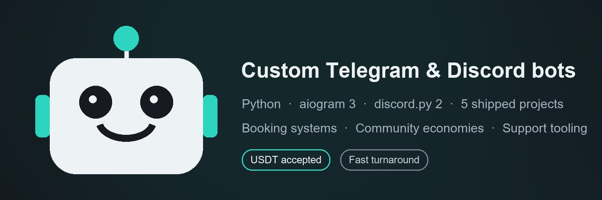

# Telegram & Discord Bot Developer

Python developer building production bots for businesses and online communities. 5 shipped projects, all in active use.

| Project | What it does | Stack |
|---|---|---|
| [salon-booking-bot](https://github.com/USERNAME/salon-booking-bot) | Booking for salons & barbershops: availability calendar, loyalty program, tickets with appeals, admin panel, Excel export, push reminders | aiogram 3 · SQLite · APScheduler |
| [discord-casino-eco](https://github.com/USERNAME/discord-casino-eco) | Community ecosystem: 4 games, coin economy, role shop, pets with evolution, PvP arena with ELO, drawing canvas | discord.py 2 · SQLite |
| [discord-tickets](https://github.com/USERNAME/discord-tickets) | Support tickets: private channels, transcripts, announcements | discord.py 2 |
| [discord-welcome-cards](https://github.com/USERNAME/discord-welcome-cards) | Personalized welcome images with avatars | discord.py 2 · Pillow |
| [discord-auto-reactions](https://github.com/USERNAME/discord-auto-reactions) | Auto-reactions utility | discord.py 2 |

**Stack:** Python 3.10+ · aiogram 3 · discord.py 2 · SQLite · Pillow · APScheduler

**Available for custom work** — bots adapted to your community or business, delivered with README and deploy guide.
Payment: USDT accepted. Contact: [@your_telegram](https://t.me/your_telegram)
